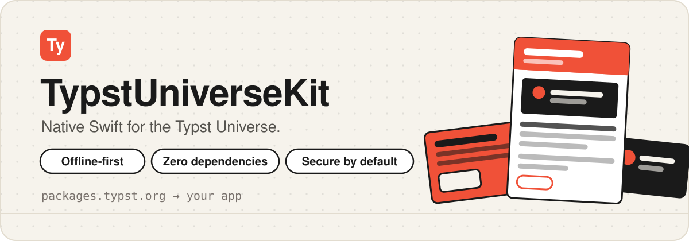

<p align="center">
  
</p>

<p align="center">
  <a href="https://swift.org"></a>
  <a href="https://swift.org/package-manager/"></a>
  <a href="https://developer.apple.com/ios/"></a>
  <a href="https://developer.apple.com/macos/"></a>
  <a href="https://developer.apple.com/visionos/"></a>
  <a href="https://swift.org/server/"></a>
  <a href="LICENSE"></a>
  <a href="https://github.com/VM451/TypstUniverseKit/actions/workflows/ci.yml"></a>
</p>

<p align="center">
  <strong>Search, download, and scaffold the entire <a href="https://packages.typst.org">Typst Universe</a> right inside your Apple app.</strong><br />
  Zero dependencies · Offline-first · Strict Swift 6
</p>

<p align="center">
  <a href="#quick-start-template-picker-in-15-lines">Quick start</a> ·
  <a href="#headless-usage">Headless</a> ·
  <a href="#customizing-the-ui">Customization</a> ·
  <a href="#how-it-works">Architecture</a> ·
  <a href="#security">Security</a> ·
  <a href="#contributing">Contributing</a>
</p>

**TypstUniverseKit** brings the entire [Typst Universe](https://packages.typst.org) package registry — thousands of templates, CVs, theses, presentations, and drawing libraries — into native macOS, iOS, iPadOS, and visionOS apps. Pick a lane:

| Lane | Modules | For |
|---|---|---|
| **Headless** | `TypstUniverseCore` + `TypstUniverseStorage` | Custom editors, IDE builders, server-side Swift, enterprise tooling |
| **Turnkey UI** | + `TypstUniverseUI` | Any SwiftUI app that wants a Pages-style template chooser in minutes |

- **Zero runtime third-party dependencies.** Foundation, URLSession, ImageIO, and pure-Swift gzip/TAR/TOML only. (The Swift-DocC plugin is build tooling, never linked into products.)
- **Offline-first.** Stale-while-revalidate catalog sync (ETag / `If-None-Match`); full browsing in Airplane Mode after first sync.
- **Secure by default.** Tar-slip, symlink, and decompression-bomb guards; HTTPS-only; atomic installs; zero-tracking privacy manifest.
- **Strict Swift 6.** Sendable value models, actor-isolated caches, `@Observable` UI, zero warnings.

---

## Contents

- [Requirements](#requirements)
- [Installation](#installation)
- [Quick start: template picker in ~15 lines](#quick-start-template-picker-in-15-lines)
- [Headless usage](#headless-usage)
- [Customizing the UI](#customizing-the-ui)
- [How it works](#how-it-works)
- [Security](#security)
- [Testing](#testing)
- [Documentation](#documentation)
- [Examples](#examples)
- [Roadmap](#roadmap)
- [Contributing](#contributing)
- [License](#license)

---

## Requirements

| | Minimum |
|---|---|
| Swift | 6.2+ (strict concurrency, `-strict-concurrency=complete`) |
| Xcode | 26+ (SwiftUI macros require the Xcode toolchain, not CLT alone) |
| iOS / iPadOS | 26.0+ |
| macOS | 26.0+ |
| visionOS | 26.0+ |
| Linux | Core module only (server-side indexing/validation) |

> Building from the command line? Use the Xcode toolchain:
> `DEVELOPER_DIR=/Applications/Xcode.app/Contents/Developer swift build`

## Installation

### Swift Package Manager (`Package.swift`)

```swift
dependencies: [
    .package(url: "https://github.com/VM451/TypstUniverseKit", from: "1.0.0")
],
targets: [
    .target(name: "MyApp", dependencies: [
        .product(name: "TypstUniverseCore", package: "TypstUniverseKit"),
        .product(name: "TypstUniverseStorage", package: "TypstUniverseKit"),
        .product(name: "TypstUniverseUI", package: "TypstUniverseKit"), // SwiftUI apps only
    ])
]
```

Only pay for what you use: headless apps can depend on `TypstUniverseCore` alone; add `TypstUniverseStorage` for downloads/scaffolding, `TypstUniverseUI` for the ready-made browser.

### Xcode

1. **File → Add Package Dependencies…**
2. Enter `https://github.com/VM451/TypstUniverseKit`
3. Add the products you need to your target.

---

## Quick start: template picker in ~15 lines

```swift
import SwiftUI
import TypstUniverseStorage
import TypstUniverseUI

struct NewDocumentSheet: View {
    @Environment(\.dismiss) private var dismiss

    var body: some View {
        TemplatePickerSheet(
            client: .shared,
            initialCategory: .cv,
            destinationProvider: { spec in
                FileManager.default.temporaryDirectory
                    .appending(path: "\(spec.name)-\(UUID().uuidString)")
            }
        ) { project in
            print("Ready to open: \(project.entrypointURL)")
            dismiss()
        }
    }
}
```

Present it as a sheet — the user browses, picks **Use Template**, and your completion handler receives a `ScaffoldedTemplateProject` (destination root, entrypoint file, created files, source spec).

## Headless usage

No UI needed? Drive the registry, search, and scaffolding directly:

```swift
import TypstUniverseCore
import TypstUniverseStorage

// 1. Sync the catalog (cached instantly, revalidated via ETag in the background)
let universe = TypstUniverseClient.shared
let catalog = try await universe.syncCatalog()

// 2. Search & filter locally — no network, MainActor never blocked
let results = await universe.search(UniverseQuery(
    text: "thesis",
    kind: .templatesOnly,
    categories: [.thesis, .paper],
    disciplines: [.computerScience],
    compatibleWithCompiler: SemanticVersion(0, 14, 0),
    sort: .recentlyUpdated
))

// 3. Download + scaffold a template into a project folder (like `typst init`)
let spec = PackageSpec(namespace: .preview, name: "basic-resume", version: SemanticVersion(0, 2, 8))
let project = try await universe.scaffoldTemplate(spec, to: newDocumentFolderURL)
print("Ready to open: \(project.entrypointURL)")
```

More recipes:

```swift
// Ready-to-paste Typst snippet for a detail screen
package.importSnippet()   // #import "@preview/cetz:0.3.1": *
package.initCommand()     // typst init @preview/cetz:0.3.1

// Live download progress (queued → downloading → extracting → installed)
for await event in await universe.fetch(spec) {
    if case let .downloading(p) = event { progressView.progress = p }
}

// In-memory scaffold for FileWrapper / SwiftData / Core Data hosts
let files: [String: Data] = try await universe.scaffoldInMemory(spec)

// Curated storefront sections
let fresh = UniverseSearchEngine().newAndRecentlyUpdated(catalog) // ≤ 30 days
let cvs = CuratedCollection.presets[1].packages(in: catalog)

// Official templates, maintained by the Typst team
// (github.com/typst/templates, published as @preview packages,
// so they sync, download, and scaffold through the normal paths)
let official = CuratedCollection.officialTemplates.packages(in: catalog)

// Point at a private registry or merge @local packages
let client = TypstUniverseClient.live(configuration: .init(
    storageDirectory: appSupportURL.appending(path: "TypstPackages"),
    registry: MyEnterpriseRegistry(),
    localDirectories: [localPackagesURL]
))
```

## Customizing the UI

```swift
TypstUniverseBrowserView(model: model)
    .typstUniverseConfiguration(.init(lockedKind: .templatesOnly))
    .onTemplateSelected { package, version in analytics.track(package.name) }
    .onTemplateScaffolded { project in store.open(project) }
    .onPackageImportCopied { snippet in toast("Copied") }
```

- `.typstUniverseConfiguration(_:)` — lock the browser to templates-only, pre-select a category, set accent color, hide the import snippet.
- `.onTemplateSelected` / `.onTemplateScaffolded` / `.onPackageImportCopied` — observe without forking the views.
- `TypstLivePreviewProviding` — inject your own Rust/WASM Typst renderer next to the static WebP preview.
- Every card, chip, picker, and progress indicator carries VoiceOver labels, scales with Dynamic Type (including Accessibility sizes), respects Reduce Motion and Increased Contrast, and mirrors for RTL layouts.

For fully custom layouts, compose the primitives directly: `TemplateCardView`, `CategoryPill`, `VersionBadge`, `ImportCopyButton`, `PackageDetailView`, `CategorySidebarView`, `PackageGridView`.

---

## How it works

```
┌─ TypstUniverseCore (Foundation only, incl. Linux) ──────────────┐
│ Models: SemanticVersion, UniverseCategory (19),                 │
│   UniverseDiscipline, PackageSpec, UniversePackage,             │
│   TypstManifest, CuratedCollection, TypstUniverseError          │
│ Registry: TypstRegistryProvider, OfficialUniverseRegistry      │
│   (ETag), IndexDecoder, VersionGrouper                          │
│ Search: UniverseQuery, UniverseSearchEngine (facets + sort)     │
│ Parsing: TypstTomlParser (pure Swift, typst.toml only)          │
└──────────────────────────────┬──────────────────────────────────┘
                               │ depends on
┌─ TypstUniverseStorage ───────▼──────────────────────────────────┐
│ SecureTarGzExtractor (pure-Swift gzip + USTAR, security-first)  │
│ PackageCacheManager (actor: dedup, atomic install, LRU cap)     │
│ TemplateScaffolder (typst init: disk + in-memory)               │
│ LocalNamespaceScanner (@local merge) · TypstUniverseClient      │
└──────────────────────────────┬──────────────────────────────────┘
                               │ depends on
┌─ TypstUniverseUI (SwiftUI, iOS/macOS/visionOS 26+) ─────────────┐
│ UniverseBrowserModel (@Observable state machine)               │
│ ThumbnailPipeline (NSCache + disk, ImageIO WebP off-main)       │
│ TypstUniverseBrowserView · TemplatePickerSheet                 │
│ PackageDetailView · cards, pills, badges                        │
└─────────────────────────────────────────────────────────────────┘
```

Upstream contracts (no scraping, no API keys): `…/preview/index.json` (ETag-cached) → `{name}-{version}.tar.gz` (immutable, cached) → `thumbnails/{name}-{version}[-small].webp` → `typst.toml` `[package]`/`[template]` tables. Unknown JSON fields, future categories/disciplines, and malformed dates degrade gracefully instead of failing the catalog load.

## Security

Community tarballs are untrusted input — the extractor treats them that way:

- Rejects `..` components, absolute paths, null bytes, backslashes, drive-letter paths, and over-deep paths (default max depth 32).
- Rejects symlinks, hardlinks, device nodes, and FIFOs outright.
- Enforces ceilings (defaults: 100 MB uncompressed, 5,000 files) against decompression bombs.
- Installs atomically via a unique staging directory + rename, so interrupted downloads never corrupt the cache.
- HTTPS-only archive URLs; zero tracking, zero collected data ([PrivacyInfo](Sources/TypstUniverseUI/Resources/PrivacyInfo.xcprivacy)).

See [SECURITY.md](SECURITY.md) to report a vulnerability, and the DocC article [“Archive Security”](Sources/TypstUniverseCore/Documentation.docc/Security.md) for the full model.

## Testing

```bash
# Full suite (Xcode toolchain required for the SwiftUI target)
DEVELOPER_DIR=/Applications/Xcode.app/Contents/Developer swift test

# Core only (also runs on Linux)
swift test --filter TypstUniverseCoreTests
```

Coverage: strict SemVer ordering, lenient index decoding (unknown categories, malformed dates/authors), search ranking + facet intersection + compiler filtering, TOML parsing, adversarial tar fixtures (traversal, absolute, symlink, depth, bad gzip), end-to-end scaffolding, and browser ViewModel state transitions. CI runs macOS + Ubuntu (Core), with a nightly live-schema smoke test against `packages.typst.org`.

## Documentation

- This README for the fast path.
- DocC catalogs in-source: `TypstUniverseCore/Documentation.docc` (Getting Started, Architecture, Archive Security, Searching), plus Storage and UI catalogs. Build in Xcode via **Product → Build Documentation**, or `swift package generate-documentation`.
- `Examples/UniverseExplorerApp` — a runnable multiplatform reference app.

## Examples

See [`Examples/UniverseExplorerApp`](Examples/UniverseExplorerApp) for a complete browser + “New from Template” flow on macOS, iOS, iPadOS, and visionOS.

## Roadmap

- **v1.0** — Core + Storage + UI + example app (this release).
- **v2.0 (if needed)** — SQLite/FTS5 backing store once the catalog exceeds ~25,000 entries; optional remote curated-collection feed.

Out of scope for v1.0: bundling the Typst compiler (attach your own via `TypstLivePreviewProviding`), Typst Pro account APIs, package-submission automation.

## Contributing

PRs welcome! See [CONTRIBUTING.md](CONTRIBUTING.md) for toolchain setup (Xcode vs. CLT), style rules (zero warnings, no `print()` in library code — use `KitLog`), and how to add tests. For bugs with untrusted-archive handling, read [SECURITY.md](SECURITY.md) first.

## License

Apache-2.0 — see [LICENSE](LICENSE).
